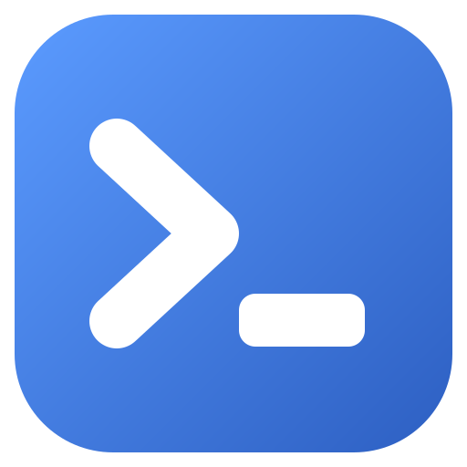
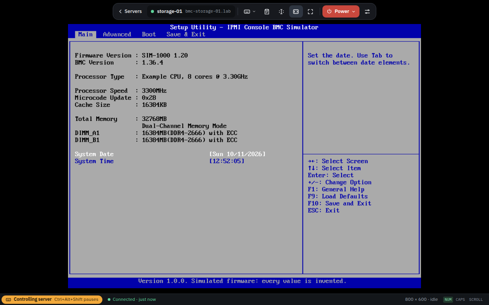
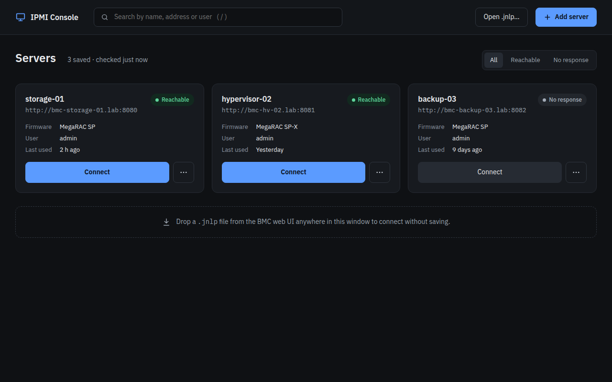
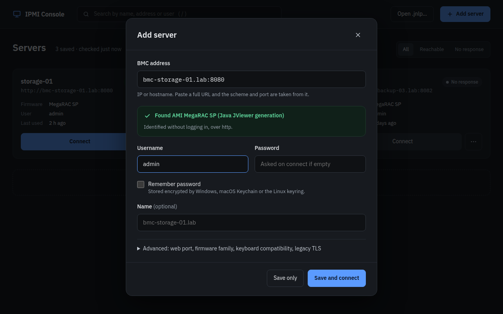

<div align="center">



# IPMI Console

## Your server's remote console. No Java required.

**Open the KVM console of any AMI MegaRAC server in a fast desktop app.<br />
Download, double-click, connect. That's it.**

[](../../releases/latest)
[](../../releases/latest)
[](../../releases/latest)


[](LICENSE)

<br />



</div>

---

### ☕ Forget Java

The BMC's built-in console (JViewer) needs Java Web Start: an old Java version, security
exceptions, certificate warnings, and a browser that still allows it. **IPMI Console needs none
of that.** It's a normal app that talks to your BMC directly.

### ⚡ Running in a minute

| | Get it | Run it |
|---|---|---|
| **Windows** | `.exe` installer, or the portable `.exe` | Double-click. If SmartScreen appears: **More info → Run anyway** |
| **macOS** <sub>preview</sub> | `-mac-arm64.dmg` for Apple silicon (M1 or newer), `-mac-x64.dmg` for Intel | Drag to Applications. First time: open it, then **System Settings → Privacy & Security → Open Anyway** |
| **Linux** | `.AppImage` | `chmod +x IPMI*.AppImage` and run it |

Then click **Add server**, type your BMC's address, and connect. Something not working? See
[troubleshooting](docs/troubleshooting.md).

### ✨ What you get

- **Just start typing.** Keyboard and mouse go to the server: no click to capture. **Ctrl+Alt+Shift** pauses.
- **Paste into the server.** **Ctrl+Alt+V** types your clipboard (US, UK, German, French, Spanish, Japanese layouts).
- **Copy from the screen.** **Ctrl+Alt+C**, then select text on BIOS, boot and console screens like in a terminal.
- **Power in two clicks.** On, soft shutdown, off, hard reset, cycle, with the BMC's answer shown.
- **All your servers in one list,** with live reachability and passwords saved in your OS keychain (Credential Manager, Keychain, keyring).
- **Stays connected.** Network blips reconnect automatically.
- **Secure by default.** Self-signed BMC certificates are trusted only after you check the fingerprint.

<table>
<tr>
<td width="50%"></td>
<td width="50%"></td>
</tr>
<tr>
<td align="center"><sub>Your servers at a glance</sub></td>
<td align="center"><sub>The BMC is identified before you log in</sub></td>
</tr>
</table>

### 🖥️ Works with

| BMC firmware | Typical servers | Status |
|---|---|---|
| **AMI MegaRAC SP** (Java JViewer era) | ASRock Rack, ASUS ASMB, Lenovo ThinkServer and others (AST2050–AST2500) | ✅ Working (see [tested hardware](#tested-hardware)) |
| **AMI MegaRAC SP-X** (HTML5 viewer era) | Newer ASRock Rack and ASUS, Tyan, OVH (AST2500/2600) | 🧪 Experimental |

Supermicro, iDRAC, iLO and OpenBMC are recognised but not supported yet. Board by board:
[compatibility](docs/compatibility.md).

### 🗺️ Coming soon

Virtual media (mount an ISO) · automatic updates · copying text from graphical screens · more typing layouts

<details>
<summary><b>Keyboard shortcuts</b></summary>

| Shortcut | What it does |
|---|---|
| **Ctrl+Alt+Shift** | Pause input to the server (click the screen to resume) |
| **Ctrl+Alt+V** | Type this computer's clipboard into the server |
| **Ctrl+Alt+C** | Select text on the screen: drag, double-click a word, triple-click a line, Alt+drag a column |
| **Ctrl+F11** | Full screen |

You can also drop a `.jnlp` file from the BMC's web page onto the window to connect once.
</details>

### 🛠️ For developers

Needs **Node.js 22.12+**.

```bash
npm install
npx install-electron --no            # downloads Electron itself (once)
npm start                            # build and run the app
npm test                             # unit and component tests
npm run test:e2e                     # the real app against a simulated BMC
npm run lint && npm run typecheck
npm run dist:win                     # or dist:mac, dist:linux → installers in release/
```

**Read next:** [development](docs/development.md) (tests, simulator, probe, installers, commits
and releases) and [architecture](docs/architecture.md) (how the app is put together). Commit messages
follow [Conventional Commits](https://www.conventionalcommits.org) and stay short; git hooks check
them. AI coding agents: start with [AGENTS.md](AGENTS.md).

**No hardware?** `npm run sim -- --scenario demo` starts a simulated BMC on this computer
(`npm run sim -- --list` shows all scenarios). Add server `127.0.0.1`, port `8080`, user and
password `admin`.

**Help support a new board:** run the read-only probe and attach its report to an
[issue](../../issues). The report contains no passwords or tokens.

```bash
npm run build
BMC_PASSWORD='…' node dist/cli/probe.js --host <bmc-address> --user admin
```

### Tested hardware

| Board | BMC | Firmware | Result |
|---|---|---|---|
| ASRock Rack E3C226D2I | AST2300 | MegaRAC SP | Video, keyboard, mouse, copy and paste confirmed on Windows and Linux |

Got another board working (or not)? [Open an issue](../../issues) with the probe report; see
[compatibility](docs/compatibility.md#reporting-a-board).

---

MIT licence, see [LICENSE](LICENSE). Third-party notices: [THIRD_PARTY_NOTICES.md](THIRD_PARTY_NOTICES.md).
