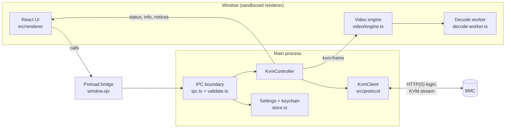

# Architecture

IPMI Console is an Electron app. The main process does all networking and keeps all secrets;
the window is a sandboxed React UI that talks to it through one small, validated API.

## Processes and layers

| Layer | Folder | Electron? | Owns |
|---|---|---|---|
| Protocol | `src/protocol` | No | Detecting the BMC, web login, the KVM session, HID reports, TLS policy, reconnection |
| Video | `src/video` | No | The ASPEED tile decoder |
| Text recognition | `src/textrec` | No | Reading text back from a decoded screen, terminal-style selection |
| Main process | `src/main` | Yes, at the edges | The window, IPC, settings, keychain, logs, the live session (`KvmController`) |
| Preload | `src/preload` | Yes | Exposes the API in `src/shared/api.ts` as `window.ojv`, nothing else |
| Renderer | `src/renderer` | Sandboxed | Screens, dialogs, input capture, the video canvas |
| Simulator | `src/sim` | No | A simulated BMC for tests, development and demos |
| CLI | `src/cli` | No | `probe` (real hardware) and `sim` |

The protocol, video, text and simulator layers, and `KvmController`, `settings.ts` and
`validate.ts`, import nothing from Electron, so they run under Vitest and the CLI unchanged.

## Connecting

`KvmClient` (`src/protocol/client.ts`) runs the whole connection:

1. **Detect the family** (`detect.ts`): unauthenticated GET requests only, scored by response
   headers and pages. Some BMCs lock accounts after failed logins, so detection never logs in.
2. **Log in** over the web API: `webauth.ts` for MegaRAC SP, `spx.ts` for SP-X.
3. **Get the launch parameters** for the KVM session (`jnlp.ts` on SP, the viewer configuration on SP-X).
4. **Choose a firmware profile** (`profiles.ts`). Generations differ in the size of the session
   handshake and a few details, such as keep-alive and the soft-reset power code. On SP, the
   profile is chosen from parameters read out of the client files the BMC itself serves
   (`jarprobe.ts`). The result is cached, so later connects only check the files haven't changed size.
5. **Open the KVM stream** (`transport.ts`, `websocket.ts`): direct TCP or TLS, the single-port
   tunnel through the web port, or a WebSocket on SP-X.
6. **Run the session** (`session.ts`): the IVTP handshake, then packet dispatch (`ivtp.ts`) for
   video, power, LEDs, mouse mode, console sharing and keep-alive.

Connecting can be cancelled at any step: each step checks for a disconnect before going on, and
the renderer ignores results from an earlier attempt. Recoverable drops reconnect with back-off;
the BMC's own stop reasons decide whether that is attempted.

### Ending a session

A BMC allows very few KVM sessions, and one left open blocks later connections until it times out.
So every exit path logs out: disconnect, closing the window, quitting, OS shutdown or log-off,
a crashed window, and Ctrl+C in the CLI (`src/main/main.ts`, `src/cli/probe.ts`). Closing stops
the KVM session, ends the stream gracefully, then logs out of the web session.

## Video

The BMC sends frames from the ASPEED video engine: an 86-byte header and a bitstream of 8×8 or
16×16 tiles (JPEG-style DCT tiles, deltas against the previous frame, or 1–4 colour VQ tiles).

1. `KvmController` forwards each frame to the window on `kvm:frame`.
2. `video/engine.ts` passes it, without copying, to a worker. The engine lives outside React and
   survives remounts, because a canvas can be handed to a worker only once.
3. `decode-worker.ts` decodes with `AspeedDecoder` (`src/video/decoder.ts`) and paints an
   `OffscreenCanvas`, so decoding never blocks the UI.

The decoder is tested pixel for pixel against ASPEED's reference decoder and against frames captured
from real hardware. Copy text (Ctrl+Alt+C) asks the worker to read the current frame with
`src/textrec`, which recognises the VGA 8×16 and 8×8 text fonts.

## Input

`useInputCapture.ts` sends keys as DOM `KeyboardEvent.code` values and the pointer as positions
normalised to the screen. There's no capture click: the screen takes keyboard and mouse input
while it has focus, and Ctrl+Alt+Shift pauses it.

`KvmController` turns these into USB HID reports (`keymap.ts`, `hid.ts`) in the keyboard style the
firmware profile, or the server's "Keyboard compatibility" setting, asks for. Blowfish encrypts the
reports when the BMC asks for it (`blowfish.ts`). Type clipboard (Ctrl+Alt+V) reads the clipboard in
the main process, so the window never sees it, and types it as key presses for the chosen host
layout (`layouts.ts`).

Input is ignored unless this session has full control: when another user shares the console, it
can be view-only or waiting for access (`KvmInfo.access`).

## The IPC boundary

`src/shared/api.ts` is the contract: the calls the window can make (`OjvApi`) and the events it
receives (`EventMap`). `src/main/ipc.ts` implements it, and treats the window as untrusted:

- Every handler checks that the message came from our own window.
- Every argument is validated in `validate.ts` before it reaches the controller or the store.
- High-rate input (keys, mouse) is fire-and-forget; invalid messages are dropped.

The window itself runs with context isolation, the sandbox and no Node.js. A content security
policy allows only the app's own files (`window.ts`), it can't navigate or open windows, and
permission requests other than full screen, pointer lock and keyboard lock are refused.

## Settings and secrets

- `settings.json` in the app's user-data folder holds saved servers, trusted certificate
  fingerprints and cached firmware fingerprints. The format is versioned and migrated forward
  (`settings.ts`); an unreadable file is moved aside, never silently lost.
- Passwords are saved only when the user asks, and only in the operating system's credential store
  (`keychain.ts`): Windows Credential Manager, the macOS Keychain, or the Secret Service on Linux
  (GNOME Keyring, KWallet). Each is an entry under the service "IPMI Console" with the server's id
  as the account; `settings.json` only records that one exists. Deleting the server or unticking
  **Remember password** removes the entry. Passwords are never logged, and the window never gets
  them back.
- TLS is verified by default. A BMC's self-signed certificate is trusted only after the user
  accepts its SHA-256 fingerprint, which is then pinned for that host (`tls.ts`).
- Logs (`log.ts`) go to the in-app log view and a daily file in the user-data `logs` folder. The
  protocol layer redacts session tokens and cookies before logging.

## The simulator

`src/sim` is a BMC: the SP or SP-X web layer, the KVM transports and the IVTP session
(`server.ts`, `ivtp-server.ts`). A scenario (`scenario.ts`) picks a firmware variant, a transport,
a video source and timed faults such as network drops, BMC stops or another user asking for access.
Video can be a text console, the navigable setup screen (`demo-screen.ts`), captured frames or a
recorded session. Unit tests, end-to-end tests and `npm run sim` all use it; see
[development.md](development.md#the-simulator).
